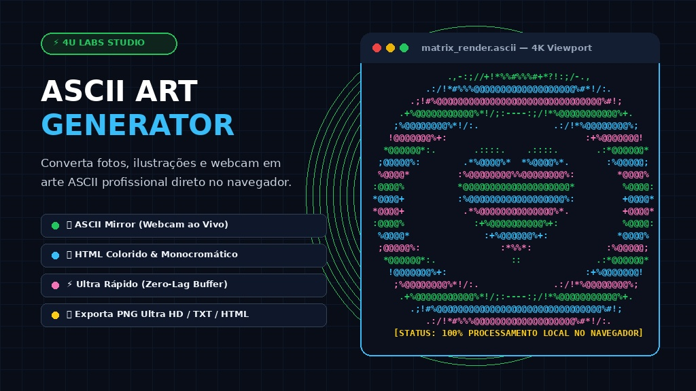

# 📟 ASCII Art Studio 4U

> Conversor de Imagens & Webcam ao Vivo em Arte ASCII de alta performance. Processamento 100% no navegador (Client-Side), zero envio de dados para servidores, exportação PNG Ultra HD, TXT e HTML.

---

## ⚡ Principais Recursos

- **Motor Zero-Lag de Alta Performance:** Leitura em lote de buffers de imagem (`Uint8ClampedArray`), acelerando o processamento em até 50x sem travar a interface.
- **ASCII Mirror (Webcam ao Vivo):** Modo espelho em tempo real que transforma o feed da câmera em caracteres ASCII ou efeito Matrix a até 60 FPS, com botão de congelamento de foto.
- **Algoritmo de Luminância Perceptiva:** Conversão baseada na sensibilidade do olho humano (ITU-R BT.601: `0.299R + 0.587G + 0.114B`) com controle de contraste, brilho e inversão de cores (negativo).
- **Dithering de Floyd-Steinberg:** Difusão de erro para gradação de sombras fotográficas e detalhes ultradefinidos em texto puro.
- **Presets de Caracteres em 1 Clique:**
  - 💎 *Ultra Denso* (`$@B%8&WM#*oahkbdpqwmZO0QLCJUYXzcvunxrjft/\|()1{}[]?-_+~<>i!lI;:,"^'. `)
  - 🧱 *Blocos Sólidos Unicode* (`█▓▒░ `)
  - 🟢 *Matrix Hacker* (`010101 `)
  - ⠿ *Braille Art* (`⣿⣶⣤⣀ `)
  - ⚡ *Minimalista* (`@%#*+=-:. `)
  - ✏️ *Texto Customizado* (repetição contínua de frases ou palavras do usuário).
- **Arrastar & Soltar + Colar da Área de Transferência:** Suporte nativo a Drag & Drop e `Ctrl+V` para capturas de tela instantâneas.
- **Exportação Multiformato:**
  - 🖼️ **Imagem PNG Ultra HD:** Renderização com fonte monoespaçada nítida e fundo temático para postar em redes sociais.
  - 📋 **Copiar Texto Puro / HTML:** Botões com feedback flutuante (toast).
  - 📄 **Arquivo .TXT:** Pronto para terminais, logs e READMEs.
  - 🌐 **Arquivo .HTML Autônomo:** Visualizador independente com CSS integrado.
- **PWA & Offline:** Funciona offline como aplicativo standalone via Service Worker e Web App Manifest.

---

## 🛠️ Tecnologias

- **HTML5 Canvas & ImageData API**
- **JavaScript ES6+ (Modular & Vanilla)**
- **CSS3 Glassmorphism & Cyberpunk Neon Theme**
- **Bootstrap 5 (Grid Utilities)**
- **WebRTC / MediaDevices (getUserMedia API)**
- **Service Worker PWA**

---

## 🌐 Acesso Online

- **URL de Produção:** [https://4u.ia.br/app/ascii/](https://4u.ia.br/app/ascii/)
- **Ecossistema:** [4u.ia.br](https://4u.ia.br/)

---

## 📄 Licença

Propriedade do ecossistema 4U Labs. Todos os direitos reservados.
